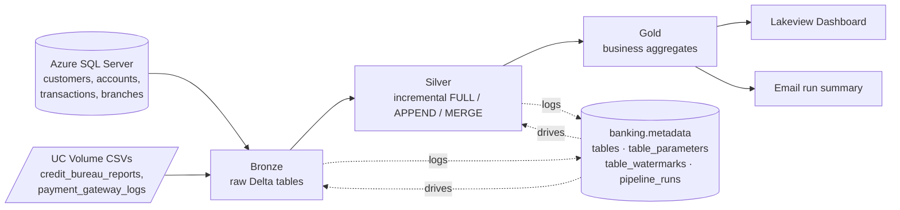

# Banking_Databricks_Project

# 🏦 NeoBank – Metadata-Driven Incremental Lakehouse on Databricks

An end-to-end data engineering project that incrementally ingests banking data from **Azure SQL Server** and **Unity Catalog Volume (CSV)** sources, processes it through a **Medallion architecture (Bronze → Silver → Gold)** using **PySpark, Delta Lake and Spark SQL**, and is fully orchestrated by a **Databricks Workflows** job. Every run is audited, and an HTML summary is emailed on completion.

The pipeline is **metadata-driven**: the list of tables, load types and watermark columns live in Delta control tables, so onboarding a new table is a few `INSERT` statements and no new code.

---

## 📑 Table of Contents

1. [Project Highlights](#-project-highlights)
2. [Architecture](#-architecture)
3. [Tech Stack](#-tech-stack)
4. [Data Sources](#-data-sources)
5. [Repository Structure](#-repository-structure)
6. [Metadata Framework](#-metadata-framework)
7. [Pipeline Walkthrough](#-pipeline-walkthrough)
8. [Gold Layer](#-gold-layer)
9. [Job Orchestration](#-job-orchestration)
10. [Dashboard](#-dashboard)
11. [Setup & Run](#-setup--run)
12. [Security](#-security)
13. [Future Improvements](#-future-improvements)
14. [Author](#-author)

---

## ✨ Project Highlights

- **Medallion architecture** on Unity Catalog (`banking` catalog with `bronze`, `silver`, `gold`, `metadata`, `source` schemas)
- **Metadata-driven framework**: one reusable code path for every table, controlled by config tables
- **Incremental loading** using stored watermarks, so only new or changed records are processed
- **Three load strategies**: `FULL` (overwrite), `APPEND`, and `MERGE` (Delta upsert on primary key)
- **Two source types**: Azure SQL Server (JDBC) and CSV files in a UC Volume
- **Audit & error handling**: every table run is logged (status, record count, error message) in `pipeline_runs`
- **Secure credentials** through Databricks Secret Scopes
- **Orchestrated with Databricks Workflows**: parallel source branches, gold layer, then notification
- **Automated email report** with a per-table execution summary
- **Business-ready Gold tables** feeding a Lakeview dashboard

---

## 🏗️ Architecture



---

## 🧰 Tech Stack

| Area | Tools |
|---|---|
| Platform | Databricks (Unity Catalog, Workflows, Lakeview, Serverless) |
| Processing | PySpark, Spark SQL |
| Storage | Delta Lake, Unity Catalog Volumes |
| Sources | Azure SQL Server (JDBC), CSV files |
| Security | Databricks Secret Scopes |
| Notifications | Python `smtplib` (Gmail SMTP) |
| Version control | Git (Databricks Repos / Git folders) |

---

## 📥 Data Sources

| Source | Entity | Notes |
|---|---|---|
| Azure SQL Server | `customers` | Incremental (MERGE) |
| Azure SQL Server | `accounts` | Incremental (MERGE) |
| Azure SQL Server | `transactions` | Incremental (APPEND) |
| Azure SQL Server | `branches` | Full reload |
| UC Volume (CSV) | `credit_bureau_reports` | Incremental (MERGE) |
| UC Volume (CSV) | `payment_gateway_logs` | Incremental (APPEND) |

Volume paths:
```
/Volumes/banking/source/volume/credit_bureau_reports/
/Volumes/banking/source/volume/payment_gateway_logs/
```

---

## 📂 Repository Structure

> Adjust folder names to match your repository.

```
Banking_Databricks_Project/
├── Setup/
│   ├── Setup_Metadata                  # catalog, schemas, volume, control tables + seed data
│   ├── Setup_secret_scope              # secret scope + connection secrets
│   └── Check_Metadata                  # inspect control tables
├── Source_to_silver/
│   ├── Read_table_list                 # active tables for a source system → task value
│   ├── Read_table_parameters           # load config for one table → task value
│   ├── Source_to_bronze                # SQL Server / Volume → Bronze (incremental)
│   └── Bronze_to_silver                # Bronze → Silver (FULL / APPEND / MERGE)
├── Silver_to_Gold/
│   ├── Silver_to_Gold                  # driver notebook, runs all gold notebooks
│   └── gold_transformation/
│       ├── customer_360
│       ├── branch_performance
│       ├── transaction_channel_summary
│       ├── daily_bank_kpi
│       └── risk_customer_summary
├── Email_notification/
│   └── Send_Email                      # HTML run summary from pipeline_runs
└── README.md
```

---

## 🗂️ Metadata Framework

All control tables live in `banking.metadata`.

| Table | Purpose |
|---|---|
| `tables` | Registry of every table: source system, schema/table or file path, bronze/silver/gold schema, `active_flag`, `load_order` |
| `table_parameters` | Key/value config per table: `load_type`, `primary_key`, `watermark_column` |
| `table_watermarks` | Last processed watermark value per incremental table (initialised to `1900-01-01`) |
| `pipeline_runs` | Audit log: `run_id`, `table_id`, `layer`, `start_time`, `end_time`, `status`, `number_of_records`, `error_message` |

**Load configuration**

| Table | Load type | Primary key | Watermark column |
|---|---|---|---|
| customers | MERGE | `customer_id` | `updated_at` |
| accounts | MERGE | `account_id` | `updated_at` |
| transactions | APPEND | `txn_id` | `txn_timestamp` |
| branches | FULL | `branch_code` | none |
| credit_bureau_reports | MERGE | `customer_id` | `bureau_pull_date` |
| payment_gateway_logs | APPEND | `txn_id` | `processed_timestamp` |

---

## 🔄 Pipeline Walkthrough

### 1. Setup
- `Setup_Metadata` creates the `banking` catalog, the `metadata` and `source` schemas, the source Volume, the four control tables, and seeds them with the table registry, parameters and initial watermarks.
- `Setup_secret_scope` creates the `banking-scope` secret scope and stores the SQL Server connection (as one JSON secret) and the email credential.

### 2. Reading the configuration
- **`Read_table_list`**: takes a `source_system` parameter (`sqlserver` or `blob`), returns the active tables ordered by `load_order`, and publishes them as the task value `tables_metadata`.
- **`Read_table_parameters`**: takes one table's metadata, fetches its rows from `table_parameters`, and publishes them as the task value `table_parameters`.

### 3. Source → Bronze (`Source_to_bronze`)
- Receives `table_metadata`, `table_parameters` and `run_id`.
- Checks `pipeline_runs` for the current run and table, and logs the start of the Bronze load.
- Reads **only new data** based on the stored watermark:
  - from **Azure SQL Server** via JDBC (credentials from the secret scope), or
  - from **CSV files in the UC Volume**.
- Writes the result to `banking.bronze.<table>` as a **Delta table**.
- Wrapped in exception handling, so failures are recorded with the error message.

### 4. Bronze → Silver (`Bronze_to_silver`)
- Reads the last watermark from `table_watermarks` and filters Bronze to rows **greater than** that value.
- Adds `insert_timestamp` and `update_timestamp` audit columns.
- Creates the Silver table on first run, otherwise applies the configured load type:

| Load type | Behaviour |
|---|---|
| `FULL` | Overwrite the table (with schema overwrite) |
| `APPEND` | Append new rows |
| `MERGE` | Delta `MERGE` on the primary key: update matches, insert new rows |

- Updates the watermark to the maximum value just processed.
- In a `finally` block, writes status, record count and error message to `pipeline_runs`.

### 5. Silver → Gold
A driver notebook (`Silver_to_Gold`) runs every notebook in `gold_transformation/`. Each one rebuilds a Gold table with `CREATE OR REPLACE TABLE` and returns its row count.

### 6. Notification
`Send_Email` reads `pipeline_runs` for the job run ID, determines the overall status (`SUCCESS` or `FAILED`), and emails an HTML table with each table's layer, start/end time, status and record count.

---

## 🥇 Gold Layer

| Table | Grain | Contents |
|---|---|---|
| `customer_360` | Customer | Total accounts, balance, transaction count and amount, latest credit score and risk grade, external loans and overdue amount, customer segment |
| `branch_performance` | Branch | Customers, accounts, deposits, transaction count and amount |
| `transaction_channel_summary` | Date × gateway × device | Total, successful and failed transactions, average processing time (ms) |
| `daily_bank_kpi` | Date | Total customers, accounts, balance, daily transactions and amount, average credit score, high-risk customers |
| `risk_customer_summary` | Risk grade | Customer count, average credit score, external loans, overdue amount |

**Customer segmentation** (by total balance): `HIGH_VALUE` ≥ 500,000 · `MEDIUM_VALUE` ≥ 100,000 · `LOW_VALUE` below 100,000.

`customer_360` takes each customer's **latest** credit bureau record using `ROW_NUMBER()` over `bureau_pull_date` and `insert_timestamp`.

---

## ⚙️ Job Orchestration

The pipeline runs as a Databricks Workflows job, **`NeoBank_Master_job`**:

```
 Source_to_silver_SQLSERVER ──┐
                              ├──► Silver_to_Gold (run if all done) ──► Send_Email
 Source_to_silver_BLOB ───────┘
```

| Task | Description |
|---|---|
| `Source_to_silver_SQLSERVER` | Runs the Source→Bronze→Silver flow for all active SQL Server tables |
| `Source_to_silver_BLOB` | Runs the same flow for the CSV/Volume tables |
| `Silver_to_Gold` | Builds all five Gold tables once both source branches finish |
| `Send_Email` | Sends the execution summary (serverless compute) |

The two source branches run **in parallel**, and the same reusable `Source_to_silver` logic serves both because the source system is passed as a parameter.

---

## 📊 Dashboard

A Lakeview dashboard built on the Gold tables:

- **Executive Dashboard**: total customers, deposits, transactions, high-risk customers
- **Customer Insights**: segment distribution, risk grade distribution, top 10 customers by balance
- **Branch Performance**: deposits, customers and transaction amount by branch
- **Gateway & Device**: successful vs. failed transactions per gateway, transactions by device type

> 📸 Add screenshots of the dashboard, the job graph and the email here.

---

## ▶️ Setup & Run

### Prerequisites
- Databricks workspace with Unity Catalog enabled
- Azure SQL Server database containing `customers`, `accounts`, `transactions`, `branches`
- Permission to create catalogs, schemas, volumes and secret scopes
- A Gmail account with an app password (for email notifications)

### Steps
1. **Clone** the repo into Databricks (Git folder) or import the notebooks.
2. **Run `Setup_Metadata`** to create the catalog, schemas, volume and control tables.
3. **Configure secrets**: enter your own values in `Setup_secret_scope` and run it (see [Security](#-security)).
4. **Upload the CSV files** to the Volume paths listed above.
5. **Create the job** `NeoBank_Master_job` with the tasks shown in [Job Orchestration](#-job-orchestration). Pass `{{job.run_id}}` to the notebooks that need `run_id`.
6. **Run the job.** Re-run it after new source data arrives and only the new records will be processed.
7. **Verify** with `Check_Metadata` and the email report.

---

## 🔐 Security

- Connection details are stored as a single JSON secret in the `banking-scope` Databricks secret scope and read with `dbutils.secrets.get`.
- **Never commit real credentials** (passwords, API keys, app passwords) to Git. Keep placeholders in the repository version of `Setup_secret_scope`.
- Do not print secret values or session tokens in notebooks.

---

## 🚀 Future Improvements

- Data quality checks (null, duplicate, range validation) between Bronze and Silver
- Auto Loader for the Volume files
- Delta Live Tables / Lakeflow Declarative Pipelines
- Schema-evolution handling and data-quality alerts
- CI/CD with Databricks Asset Bundles and automated tests
- Slack or Teams alerts alongside email

---

## 👤 Author

**[Your Name]**
[LinkedIn] • [GitHub] • [Email]
